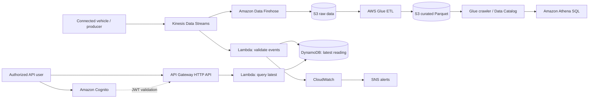
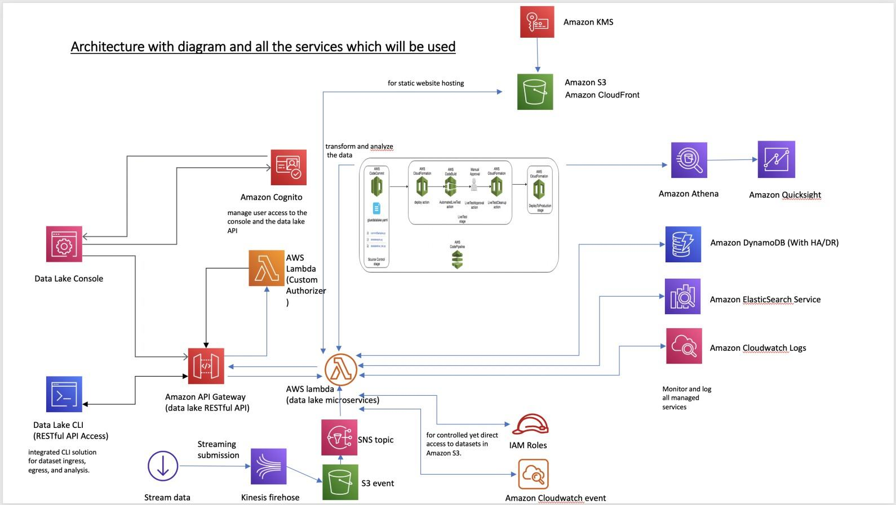

# Datasoft | AWS Data Lake Automation

**Cloud architecture capstone • AWS serverless data engineering • Python • CloudFormation / SAM**

An implementation-focused version of the *Architecting and Deploying a Data Lake Automation Solution* capstone. The fictional business, Datasoft Inc., needs a dependable place to collect incoming data, keep a current view of each device, and support analytics without manually combining files from several systems.

> **Project status:** The repository contains source code, infrastructure definitions, an executable local test suite, original architecture illustrations and deployment instructions. **It has not been deployed to an AWS account or verified at production scale.** Deployment evidence must be recorded separately.

## At a glance

| Area | What this repository provides |
|---|---|
| Ingestion | Kinesis Data Streams accepts JSON telemetry; Amazon Data Firehose archives JSONL to an S3 raw zone. |
| Stream processing | Python Lambda validates events and keeps the most recent value per device in DynamoDB. |
| Query API | API Gateway HTTP API, Cognito JWT authorizer, read-only Python Lambda and DynamoDB. |
| Batch analytics | AWS Glue Spark ETL writes curated Parquet files; Glue crawler registers tables for Athena. |
| Security | Private S3 buckets, encryption at rest, scoped runtime IAM roles, API authorization and CloudWatch alarm. |
| Delivery | SAM/CloudFormation infrastructure, GitHub Actions checks, CodeBuild starter and deployment scripts. |
| Evidence | Original capstone PDF, previous project PDF, **91 original embedded images**, testing reports and source-to-implementation mapping. |

## Architecture



**Original capstone architecture (preserved from page 4 of the assignment):**



The original illustration also names CloudFront, OpenSearch, QuickSight, KMS, Lake Formation, and multi-region features. **Those are not all part of the deployable pilot.** See the [service coverage table](docs/SERVICE_COVERAGE.md) for what's implemented, documented as an extension, or still needs testing.

## Get started in five minutes (no AWS account)

```bash
# 1. Clone after publishing this repository to your own GitHub account.
git clone https://github.com/Pacman006/aws-data-lake-automation-capstone.git
cd aws-data-lake-automation-capstone

# 2. Create a Python virtual environment.
python -m venv .venv

# Windows PowerShell:
.venv\Scripts\Activate.ps1
# macOS / Linux / WSL alternative: source .venv/bin/activate

# 3. Install local test dependencies.
python -m pip install -r requirements-dev.txt

# 4. Run unit tests and offline project checks.
python -m unittest discover -s tests -v
python scripts/check_project.py

# 5. Preview synthetic records. This makes NO AWS calls.
python scripts/produce_telemetry.py --count 3
```

If Docker is installed, run the same unit tests in a container:

```bash
docker compose run --build --rm tests
```

The Docker image is **only a local test runner**. The application in AWS uses Lambda and Glue, not containers in production.

## Deploy a pilot on AWS (charges apply)

Start with the [AWS deployment guide](docs/AWS_DEPLOYMENT.md); it includes account setup, cost checkpoints, AWS SAM installation, publishing the Glue script, sending records, running ETL, querying Athena, and cleaning up.

```bash
# Check local prerequisites and AWS identity.
python scripts/preflight.py --aws

# macOS/Linux/WSL/Git Bash, from repository root:
bash scripts/deploy.sh

# Windows PowerShell:
.\scripts\deploy.ps1
```

**Do not deploy without reviewing expected AWS charges and IAM resources.** Kinesis, Firehose, Glue, API Gateway, DynamoDB, CloudWatch and S3 can accrue charges. There is no production warranty or estimated monthly cost in this repository.

## Project structure

```text
cloudformation/    AWS SAM / CloudFormation stack
src/               Telemetry processor, read API and input validation
glue/              Spark ETL to partitioned Parquet
scripts/           Preflight, deploy, producer, job runner, Athena and smoke tests
tests/             Offline unit tests (mocked AWS clients)
fixtures/          Sample newline-delimited JSON telemetry
.github/workflows/ GitHub Actions continuous integration
buildspec.yml      Standalone CodeBuild validation job
Dockerfile         Local test container (not an application image)
docs/              Design decisions, setup guides and original image gallery
reports/           Source review, validation report and AWS evidence checklist
```

## Documentation

| Document | Why it matters |
|---|---|
| [Architecture and data flow](docs/ARCHITECTURE.md) | Design choices, major components, failure paths, diagrams |
| [AWS deployment guide](docs/AWS_DEPLOYMENT.md) | Commands, prerequisites, expected results, cleanup |
| [Local testing and Docker](docs/LOCAL_TESTING.md) | How to run everything without an AWS bill |
| [Security and governance](docs/SECURITY.md) | IAM, encryption, user authentication, data stewardship |
| [Operations and troubleshooting](docs/OPERATIONS.md) | Alerts, pipeline checks, error investigation, recovery |
| [Availability, DR and cost](docs/DR_AND_COST.md) | Recovery choices, pricing factors, operational limits |
| [Service coverage matrix](docs/SERVICE_COVERAGE.md) | Accurate implemented vs. planned feature status |
| [Original images gallery](docs/ORIGINAL_IMAGES.md) | Preserved AWS service screenshots and page references |
| [GitHub publishing guide](docs/GITHUB_SETUP.md) | Instructions for the **Pacman006** account |
| [Source review and improvement plan](reports/ARCHITECTURE_ASSESSMENT.md) | Why this revision improves on the source reports |
| [Requirements traceability](reports/REQUIREMENTS_TRACEABILITY.md) | Original scope versus implemented source, and why some features remain extensions |
| [Deployment evidence template](reports/AWS_EVIDENCE_TEMPLATE.md) | Record real results without inventing them |

## Example telemetry schema

```json
{
  "event_id": "demo-001",
  "device_id": "vehicle-001",
  "event_time": "2026-11-16T09:00:00Z",
  "speed_kmh": 55.7,
  "fuel_percent": 73.1,
  "diagnostic_codes": []
}
```

The producer appends `\n` to each Kinesis payload so Data Firehose can concatenate records into S3 **JSON Lines** objects. The Lambda worker validates the reading before it writes to DynamoDB. Incorrectly formatted records are logged and discarded; the raw stream is separately archived in S3 for investigation. A conditional write stops replayed or older readings from replacing newer ones.

## Known boundaries

- The **pilot** keeps only one latest reading per device in DynamoDB; full history lives in S3.
- Glue outputs Parquet and registers a catalog table only **after** the batch job and crawler are run. Global historical deduplication across multiple job runs is not implemented.
- CodePipeline, CodeCommit, CloudFront, OpenSearch, QuickSight, KMS customer-managed keys, Lake Formation grants, S3 cross-region replication and DynamoDB Global Tables are **not automatically provisioned**. They are described as follow-up work in the documents.
- Sample data is synthetic. Do **not** upload actual customer information, secrets, AWS access keys or unreviewed screenshots.
- The original PDFs and screenshots were preserved. **Review all screenshots for account identifiers, URLs, usernames and other private details before making a public GitHub repository.**

## Original material

- [Capstone assignment PDF](docs/source/capstone_assignment.pdf) — project requirements and original service diagram.
- [Previous project report PDF](docs/source/original_project_report.pdf) — original step screenshots and implementation notes.
- [Screenshots / images by page](docs/ORIGINAL_IMAGES.md) — original embedded images extracted without changing their content.

This project is an educational reference implementation derived from the two supplied capstone PDFs. Company names and sample data are illustrative. Original educational images retain the rights of their respective owners; their inclusion is for traceability and should be checked before public distribution.
