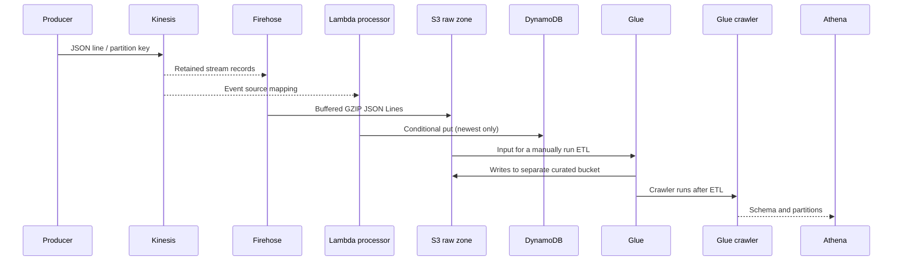
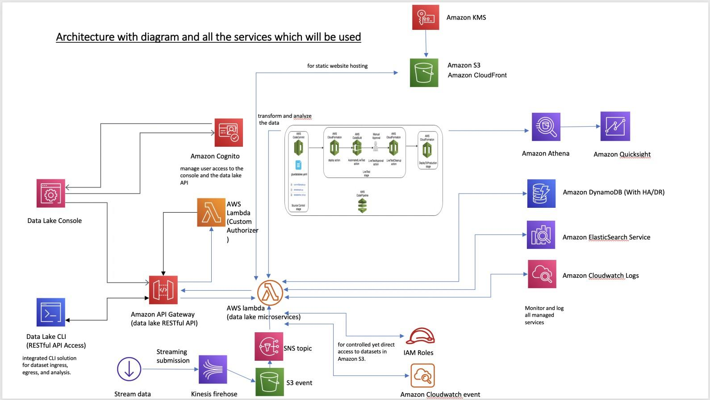

# Architecture and data flow

## Business context

The capstone describes **Datasoft Inc.**, a fictional company dealing with rapidly increasing data volumes and disconnected data sources. The goals are to collect structured and semi-structured data, keep it securely, make it searchable/queryable and give authorized consumers a stable analytics platform. The assignment explicitly asks for ingest, decode, transform, analyze and consume stages.

## Implementation baseline

This repository implements an AWS **pilot**, not an enterprise-wide finished platform. The infrastructure is defined in `cloudformation/template.yaml` using AWS SAM, which transforms into AWS CloudFormation. This keeps the solution aligned with the original CloudFormation requirement while packaging Python Lambda functions from local source directories.

## Service decisions

**Kinesis Data Streams** is the common entry point. Its 24-hour stream retention provides a limited replay window, not permanent storage. A single provisioned shard is a learning baseline; monitor ingest limits and resize as measured load demands. The consumer starts at `LATEST`, so historical records are not backfilled automatically after deployment.

**Amazon Data Firehose** reads the same stream and buffers records to a private, versioned raw S3 bucket. Sample payloads end with a newline, allowing Firehose's concatenation behavior to produce valid JSON Lines. It compresses output with GZIP; the objects can be read by Glue. Buffering means S3 objects are not created immediately after a single event.

**AWS Lambda** validates incoming events, normalizes timestamps to UTC and updates a `device_id` key in DynamoDB only if the reading is newer. Lambda's event source mapping uses partial-batch failure reporting to retry transient write errors. Input schema errors are logged, not retried indefinitely. The raw S3 zone is the source for later reprocessing or analysis.

**DynamoDB** is an operational, low-latency *latest reading* view. It is not the authoritative historical store. The API only allows `GetItem`; it has no create/update route.

**Cognito + API Gateway** protect the `GET /devices/{device_id}/latest` endpoint with a JWT authorizer. The authentication flow and demo user setup are documented. Public signup is disabled. For real company use, add groups, MFA, per-tenant authorization and an identity federation strategy; a valid JWT alone does not enforce device-level access restrictions.

**Glue ETL + curated S3 + Glue Data Catalog + Athena** support batch analytics. A Glue Spark job reads raw objects, filters invalid values, removes duplicate event IDs *within the current job run*, and writes partitioned Parquet. A crawler creates/updates Athena tables. Glue job bookmarks help prevent re-reading processed source files in normal operation; they do not guarantee end-to-end exactly-once semantics.

**CloudWatch + SNS** provide a Lambda error alarm and a notification topic. Subscribe an operations mailbox manually and confirm the subscription. The starter doesn't set up a full incident management or observability program.

## Data zones

| Zone | Location | Data | Access intention |
|---|---|---|---|
| Raw | S3 raw bucket, `raw/year=.../month=.../day=.../` | Original JSONL, GZIP-compressed | Ingestion and ETL service roles |
| Curated | S3 curated bucket, `telemetry/event_date=YYYY-MM-DD/` | Filtered Parquet | ETL, query tools, authorized analysts |
| Artifacts | S3 artifacts bucket, `glue/`, `athena-results/` | Glue code, query outputs and temporary files | Build/admin and analyst roles |
| Operational | DynamoDB latest table | Latest validated reading per device | Processor write and read-only API |

## Original design image

This image is retained as a historical reference. It shows more AWS services and workflows than the deployable pilot. The [service coverage matrix](SERVICE_COVERAGE.md) identifies the difference.

## Reliability and failure analysis

| Failure | Pilot behavior | Engineering improvement |
|---|---|---|
| Producer sends malformed JSON | Worker logs/rejects; Firehose still archives original payload | Store a structured rejection log, dead-letter strategy and schema registry |
| DynamoDB becomes unavailable | Partial-batch response retries failed records | Add alert on iterator age, failed records, and replay runbook |
| A record arrives twice | Conditional write prevents older/equal timestamps from replacing the latest value | Persist event IDs to provide stronger dedup across analytics pipeline |
| Firehose can't write S3 | Delivery retries and logs errors according to service behavior | Monitor delivery-failure metrics and define replay/recovery process |
| Glue ETL fails | Run remains failed; raw S3 data is retained | Add workflow retries, separate bad-record store and tested recovery |
| Region goes down | No automatic failover in this pilot | Implement and test S3 replication, data recovery, API/compute standby and DNS cutover |

## Accepted trade-offs

1. The project uses serverless and managed services to minimize server administration, at the cost of usage-based pricing.
2. Kinesis and Glue are not a zero-cost demo; testing must use small datasets and have a budget alarm.
3. S3 bucket `DeletionPolicy: Retain` and DynamoDB table retention protect against accidental deletion. They also require manual cleanup and may continue billing after stack deletion.
4. Single-region deployment is an explicit pilot constraint. Multi-region screenshots in the original report are evidence of an earlier walkthrough, **not proof of this repository's DR capability**.
5. No customer-managed KMS key, search cluster or public website is deployed by default because those need separate threat modelling, operations and cost decisions.
