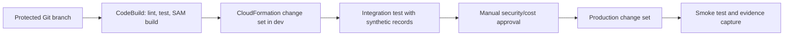

# CI/CD and version control plan

## What is implemented now

- **GitHub Actions** executes Python unit tests, performs source/template checks, validates SAM syntax and runs a local Docker test image.
- **`buildspec.yml`** can be attached to a CodeBuild project to run offline Python checks.
- **`scripts/deploy.sh` and `scripts/deploy.ps1`** execute a reviewed SAM/CloudFormation deployment after confirmation.

The GitHub Actions workflow does **not** deploy to AWS. A successful CI run means that the checked source and test commands passed in GitHub's runner, not that an AWS data lake exists.

## Proposed AWS release pipeline (not created by the current template)

1. Connect a protected GitHub branch (or an AWS CodeCommit repository) to CodePipeline through the supported source action.
2. Build and package Lambda source via SAM; do not package deployment secrets.
3. Use environment-specific IAM deployment roles. Review change sets for new public access, data deletion or IAM escalation.
4. Deploy dev/stage first and test the actual S3, Lambda, DynamoDB, Glue and API integrations.
5. Require a human approval action before prod changes. Capture the approver and the exact revision.
6. Record production smoke tests and rollback instructions.

The original project screenshots show CodeCommit and CodePipeline. CodeCommit is open to new customers again as of November 2025, but **GitHub is the intended portfolio repository** here. See [AWS CodeCommit general availability announcement](https://aws.amazon.com/blogs/devops/aws-codecommit-returns-to-general-availability/).

## Branch strategy

- `main`: reviewed documentation and source.
- Feature branches: changes for processing logic, IaC, data transformations and security policies.
- Tags: use semantic release tags (`v0.1.0`) after tests and reviews.

**Never** automatically apply data-destructive CloudFormation changes as part of a public pull request workflow.
