# Gallery of original project images

This page indexes **original embedded images**, copied directly from the two uploaded PDF documents (not redrawn). The two complete PDFs are retained under `docs/source/`. The source page is listed so you can trace every image to the submitted material.

> **Publishing check:** These are historical AWS screenshots. Review for account numbers, usernames, email addresses, credentials and other identifiers before sharing a public repository. UI labels and service names may have changed since the screenshots were captured.

## Original capstone assignment (8 pages)

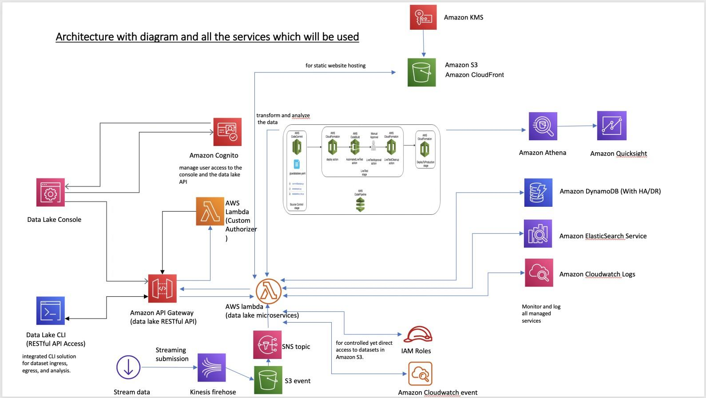

**Above:** original AWS services diagram from the capstone assignment, page 4. It shows the intended architecture, not the scope of the deployable pilot.

## Earlier final project report (32 pages)

### Selected reference screenshots

**AWS IAM: roles** — original report page 2

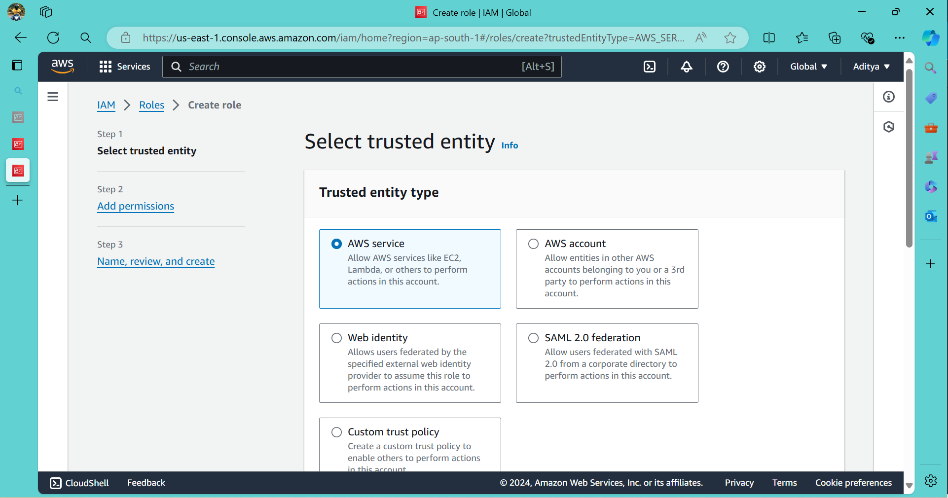

**Amazon S3: storage setup** — original report page 3

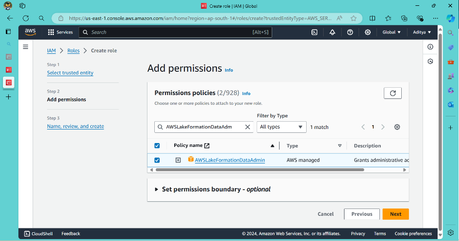

**CloudFormation: template development** — original report page 5

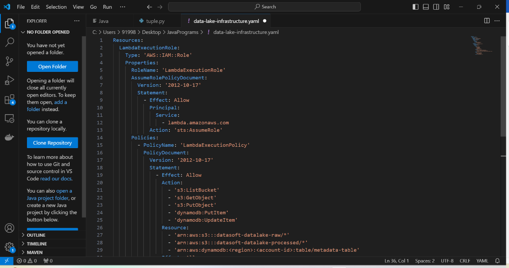

**AWS Lambda and Glue** — original report page 9

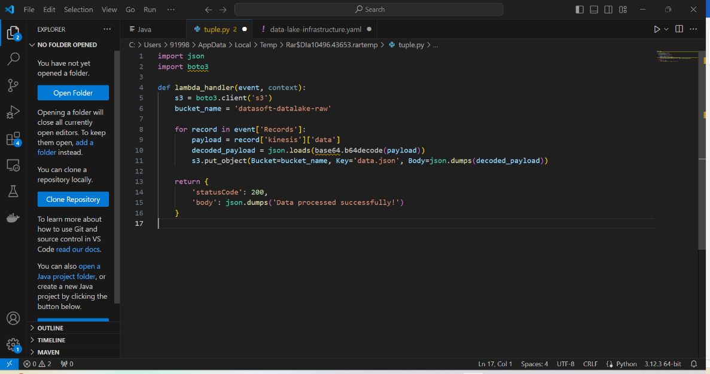

**CodePipeline / AWS Glue** — original report page 14

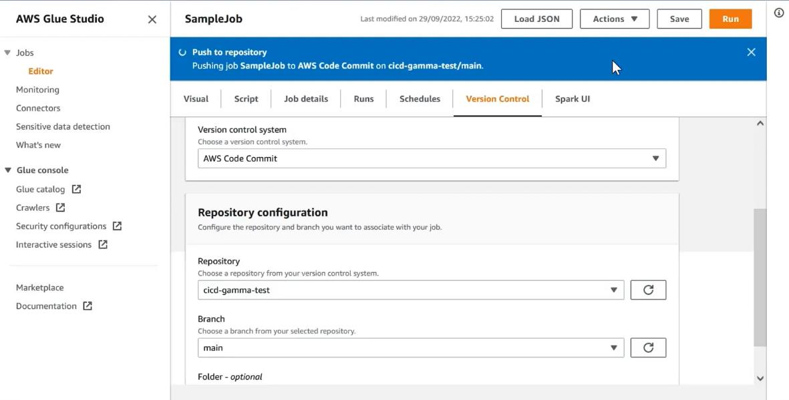

**S3 encryption** — original report page 16

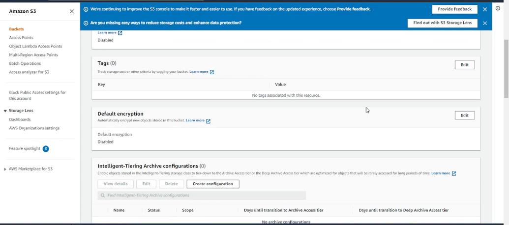

**S3 regional replication** — original report page 20

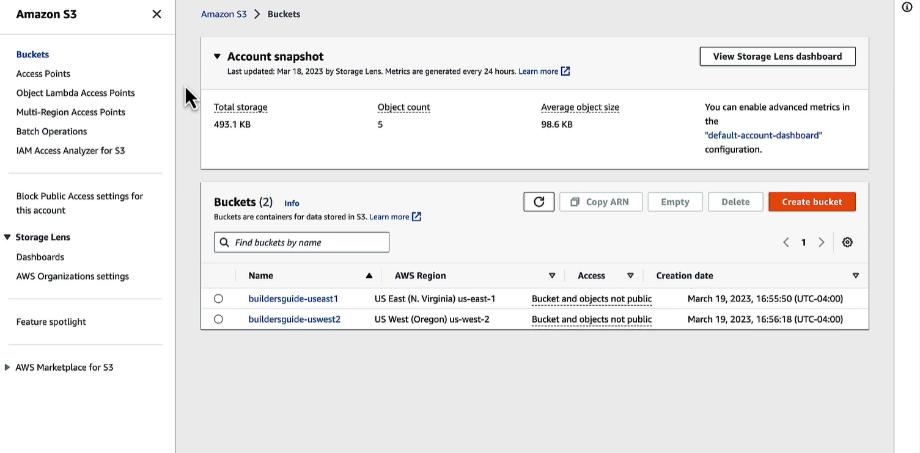

**DynamoDB Global Tables** — original report page 22

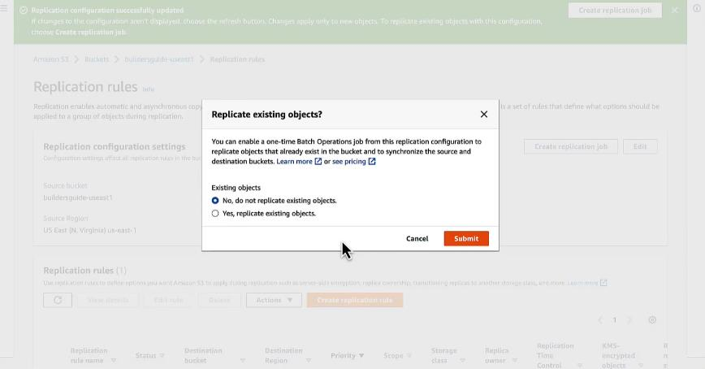

**Lambda setup** — original report page 24

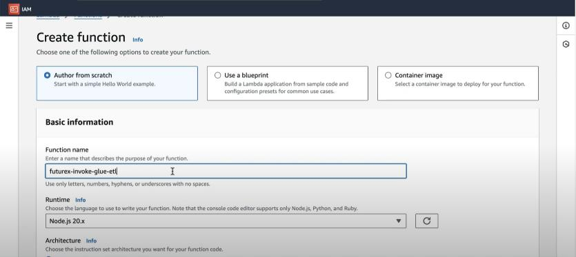

**CI/CD** — original report page 26

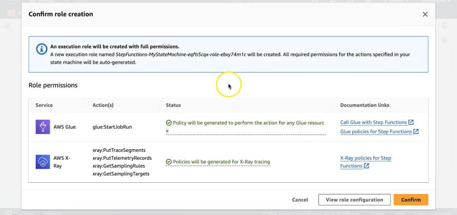

## Complete image index

Each link points to an unchanged extracted image. The same images also remain inside the original PDF files.

| Source | PDF page | Images |
|---|---:|---|
| Capstone assignment | 1 | [Image 1](images/original/assignment_p01_01.jpeg), [Image 2](images/original/assignment_p01_02.png) |
| Capstone assignment | 4 | [Image 1](images/original/assignment_p04_01.jpeg) |
| Original final report — IAM roles | 2 | [Image 1](images/original/student-report_p02_01.png), [Image 2](images/original/student-report_p02_02.png) |
| Original final report — S3 and IAM | 3 | [Image 1](images/original/student-report_p03_01.png), [Image 2](images/original/student-report_p03_02.jpeg), [Image 3](images/original/student-report_p03_03.png) |
| Original final report — S3 storage | 4 | [Image 1](images/original/student-report_p04_01.jpeg), [Image 2](images/original/student-report_p04_02.png), [Image 3](images/original/student-report_p04_03.png), [Image 4](images/original/student-report_p04_04.png) |
| Original final report — CloudFormation template | 5 | [Image 1](images/original/student-report_p05_01.png), [Image 2](images/original/student-report_p05_02.jpeg) |
| Original final report — Service execution roles | 6 | [Image 1](images/original/student-report_p06_01.png), [Image 2](images/original/student-report_p06_02.png), [Image 3](images/original/student-report_p06_03.png) |
| Original final report — CloudFormation / roles | 7 | [Image 1](images/original/student-report_p07_01.png), [Image 2](images/original/student-report_p07_02.png), [Image 3](images/original/student-report_p07_03.png) |
| Original final report — CloudFormation and Kinesis | 8 | [Image 1](images/original/student-report_p08_01.png) |
| Original final report — Lambda and Glue crawler | 9 | [Image 1](images/original/student-report_p09_01.png), [Image 2](images/original/student-report_p09_02.png) |
| Original final report — Glue job and sample data | 10 | [Image 1](images/original/student-report_p10_01.png) |
| Original final report — ETL code and CodeCommit | 12 | [Image 1](images/original/student-report_p12_01.png), [Image 2](images/original/student-report_p12_02.png), [Image 3](images/original/student-report_p12_03.jpeg) |
| Original final report — Glue version control | 13 | [Image 1](images/original/student-report_p13_01.jpeg), [Image 2](images/original/student-report_p13_02.jpeg) |
| Original final report — CodePipeline and Glue | 14 | [Image 1](images/original/student-report_p14_01.jpeg), [Image 2](images/original/student-report_p14_02.png), [Image 3](images/original/student-report_p14_03.png) |
| Original final report — S3 encryption | 16 | [Image 1](images/original/student-report_p16_01.jpeg), [Image 2](images/original/student-report_p16_02.jpeg), [Image 3](images/original/student-report_p16_03.png) |
| Original final report — S3 encryption and access | 17 | [Image 1](images/original/student-report_p17_01.png), [Image 2](images/original/student-report_p17_02.jpeg), [Image 3](images/original/student-report_p17_03.jpeg), [Image 4](images/original/student-report_p17_04.jpeg) |
| Original final report — CloudTrail and audit | 18 | [Image 1](images/original/student-report_p18_01.jpeg), [Image 2](images/original/student-report_p18_02.jpeg), [Image 3](images/original/student-report_p18_03.jpeg), [Image 4](images/original/student-report_p18_04.jpeg) |
| Original final report — CloudTrail and DR | 19 | [Image 1](images/original/student-report_p19_01.jpeg), [Image 2](images/original/student-report_p19_02.jpeg), [Image 3](images/original/student-report_p19_03.jpeg), [Image 4](images/original/student-report_p19_04.jpeg) |
| Original final report — S3 cross-region replication | 20 | [Image 1](images/original/student-report_p20_01.png), [Image 2](images/original/student-report_p20_02.jpeg), [Image 3](images/original/student-report_p20_03.jpeg), [Image 4](images/original/student-report_p20_04.png) |
| Original final report — S3 replication rules | 21 | [Image 1](images/original/student-report_p21_01.png), [Image 2](images/original/student-report_p21_02.png), [Image 3](images/original/student-report_p21_03.png), [Image 4](images/original/student-report_p21_04.jpeg) |
| Original final report — DynamoDB Global Tables | 22 | [Image 1](images/original/student-report_p22_01.jpeg), [Image 2](images/original/student-report_p22_02.png), [Image 3](images/original/student-report_p22_03.jpeg), [Image 4](images/original/student-report_p22_04.jpeg) |
| Original final report — DynamoDB replication | 23 | [Image 1](images/original/student-report_p23_01.jpeg), [Image 2](images/original/student-report_p23_02.jpeg), [Image 3](images/original/student-report_p23_03.jpeg) |
| Original final report — AWS Lambda | 24 | [Image 1](images/original/student-report_p24_01.jpeg), [Image 2](images/original/student-report_p24_02.jpeg), [Image 3](images/original/student-report_p24_03.jpeg), [Image 4](images/original/student-report_p24_04.jpeg), [Image 5](images/original/student-report_p24_05.jpeg) |
| Original final report — IAM and AWS Glue | 25 | [Image 1](images/original/student-report_p25_01.jpeg), [Image 2](images/original/student-report_p25_02.jpeg), [Image 3](images/original/student-report_p25_03.png), [Image 4](images/original/student-report_p25_04.jpeg), [Image 5](images/original/student-report_p25_05.jpeg) |
| Original final report — CI/CD and CodePipeline | 26 | [Image 1](images/original/student-report_p26_01.jpeg), [Image 2](images/original/student-report_p26_02.jpeg), [Image 3](images/original/student-report_p26_03.jpeg) |
| Original final report — CodeCommit | 27 | [Image 1](images/original/student-report_p27_01.jpeg), [Image 2](images/original/student-report_p27_02.jpeg), [Image 3](images/original/student-report_p27_03.png) |
| Original final report — CodeCommit and Git | 28 | [Image 1](images/original/student-report_p28_01.png), [Image 2](images/original/student-report_p28_02.jpeg), [Image 3](images/original/student-report_p28_03.png) |
| Original final report — Git credential setup | 29 | [Image 1](images/original/student-report_p29_01.jpeg), [Image 2](images/original/student-report_p29_02.jpeg), [Image 3](images/original/student-report_p29_03.jpeg) |
| Original final report — CodeCommit and Git CLI | 30 | [Image 1](images/original/student-report_p30_01.jpeg), [Image 2](images/original/student-report_p30_02.jpeg), [Image 3](images/original/student-report_p30_03.jpeg) |
| Original final report — Git repository push | 31 | [Image 1](images/original/student-report_p31_01.jpeg), [Image 2](images/original/student-report_p31_02.jpeg), [Image 3](images/original/student-report_p31_03.jpeg) |
| Original final report — Repository file listing | 32 | [Image 1](images/original/student-report_p32_01.png) |

**Total: 91 extracted images** (all original PDFs are retained).

For reproducibility, run `python -m pip install pymupdf` and then `python scripts/extract_original_images.py` to regenerate the extraction from the two local source PDF files.
